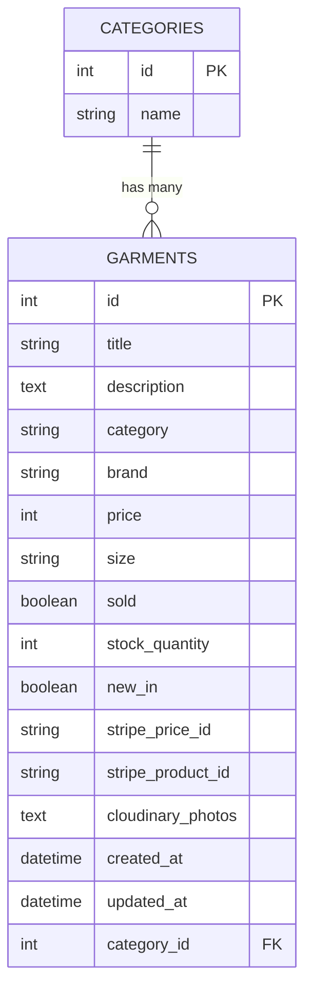

# SOURCECODE_VTG – Architecture & Database Schema

### Overview
SOURCECODE_VTG is a Ruby on Rails e-commerce platform focused on vintage streetwear.
It follows the MVC (Model-View-Controller) design pattern and integrates with third-party services for payments and media storage.

---

### System Components

- **Frontend/UI**:
  Rails Views (ERB) Bootstrap, Stimulus JS for interactivity.

- **Backend Business Logic**:
  Ruby on Rails (MVC), ActiveRecord ORM, Rails Session.

- **Persistence/DB layer**:
  PostgreSQL (development + production).

- **External Services**:
  •	Stripe Embedded Checkout for secure payments.
	•	Cloudinary Garment photo hosting.
	•	Heroku Deployment.

---

### Request Lifecycle
A typical user request flows through:

	1.	Browser Sends request.
	2.	Rails Router maps URL to controller action.
	3.	Controller processes request, queries DB/models.
	4.	Model/ActiveRecord Reads/writes data to PostgreSQL.
	5.	View (ERB) Renders HTML response for the browser.

---

### Database Schema (Current)

---

### Cart & Session Handling
	•	Items added via CartItemsController#create.
	•	Cart is stored in session[:cart] as { garment_id => quantity }.
	•	CartsController#show resolves IDs to garment objects before rendering.
	•	Ensures only valid garments are shown (next unless item avoids nils).

Future: Persist carts in DB rather than cookie to prevent potential double purchases from different buyers.

---

### Payment Flow (Stripe)
	1.	User clicks Checkout PaymentsController#create_checkout_session.
	2.	Rails converts session[:cart] Stripe line_items.
	3.	Stripe::Checkout::Session created with:
	•	ui_mode: 'embedded' (checkout iFrame).
	•	Shipping options & allowed countries.
	•	Metadata (garment IDs).
	4.	Stripe handles payment securely.
	5.	On success User redirected to thank_you_url.
	6.	App clears cart and marks garments as sold: true.

Card data never touches app server.

---

### Deployment & Environment
	•	Heroku hosts app + PostgreSQL DB.
	•	ENV variables used for:
	•	STRIPE_SECRET_KEY / STRIPE_PUBLIC_KEY.
	•	CLOUDINARY_URL.
	•	Development uses seeded garments for testing.

---

### Future Improvements
- Users & Authentication: Devise for account management.
- Orders & LineItems: Persist checkout history.
